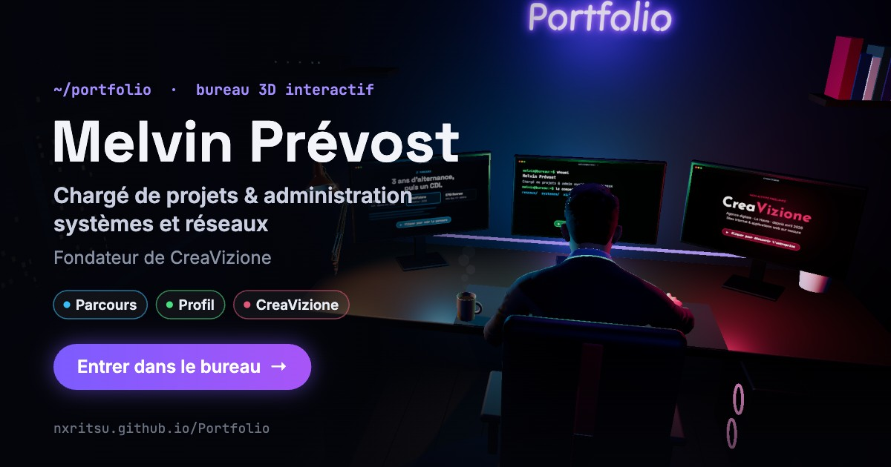

# Portfolio 3D

Mon portfolio, sous forme de bureau de nuit en 3D. On me voit de dos, devant trois écrans qu'on peut ouvrir.

[Voir le portfolio en ligne](https://nxritsu.github.io/Portfolio/)

[](https://nxritsu.github.io/Portfolio/)

## Comment ça marche

Chaque écran affiche un petit aperçu animé de ce qu'il contient. Un premier clic rapproche la caméra de l'écran, un second ouvre la fenêtre directement dans le moniteur. La pastille rouge ramène au bureau.

| Écran | Contenu |
|---|---|
| Parcours | Expériences et formations |
| Profil | Présentation façon terminal, compétences, contact |
| CreaVizione | Mon activité web, avec un lien vers le site |

Sur téléphone, la caméra cadre un seul moniteur à la fois. On passe d'un écran à l'autre en faisant défiler des cartes sous la scène, et le contenu s'ouvre dans un panneau qui monte depuis le bas. Pour le fermer : la pastille rouge, un glissement vers le bas ou le geste retour.

## Technologies

Le site est en HTML, CSS et JavaScript (modules ES), sans framework et sans étape de build. Il est hébergé sur GitHub Pages.

- [Three.js](https://threejs.org) pour la scène WebGL : lumières, ombres, bloom.
- `CSS3DRenderer` pour afficher les fenêtres HTML dans les moniteurs. Le contenu reste du vrai HTML, avec du texte sélectionnable, des liens et du défilement.
- Canvas 2D pour les aperçus animés des écrans.
- Des modèles glTF (GLB) pour le personnage et la lampe.

Le personnage est recalé automatiquement sur son animation au chargement : le clavier se place sous ses doigts et la souris suit sa paume. La forme de la souris est calculée à partir du dessous de sa main. Si un modèle 3D ne se charge pas, une version simplifiée construite dans le code le remplace.

## Performances

J'ai essayé de garder le site fluide sans faire tourner les ventilateurs.

La scène tourne à 60 images par seconde quand quelque chose bouge (caméra, souris, doigt), et descend à 30 au repos, 20 quand la fenêtre n'a pas le focus et 10 derrière le panneau sur téléphone. Elle ne dépasse jamais 60, même sur un écran 120 Hz, et s'arrête quand l'onglet est caché.

La résolution est plafonnée à 1,5× et baisse toute seule si l'appareil a du mal. Le bloom est calculé en demi-résolution et les ombres sont mises à jour une image sur deux.

Côté chargement, les modèles pèsent environ 2,3 Mo au total. Le personnage est compressé avec `KHR_mesh_quantization` et la lampe utilise des textures de 512 px. Les deux se téléchargent dès l'ouverture de la page, en même temps que les polices.

## Lancer en local

Il faut un serveur HTTP, les modules ES ne fonctionnent pas en `file://` :

```bash
python3 -m http.server 5173
```

Puis ouvrir <http://localhost:5173>.

## Structure

```
index.html          en-tête, cartes téléphone et contenu des trois fenêtres
css/style.css       styles du bureau, des fenêtres et de la version téléphone
js/main.js          rendu, caméra, navigation entre les écrans, cadence, calage du personnage
js/scene.js         pièce, bureau, moniteurs, lumières, souris, éléments de secours
js/screens.js       aperçus animés des écrans et néon
assets/             modèles GLB, image d'aperçu et icônes
```

## Crédits

- Personnage « Leonard » et animation « Typing » : [Mixamo](https://www.mixamo.com) (Adobe)
- Lampe « [Desk Lamp Arm 01](https://polyhaven.com/a/desk_lamp_arm_01) » : [Poly Haven](https://polyhaven.com), licence CC0
- [Three.js](https://threejs.org), licence MIT
- Polices Inter, JetBrains Mono, Space Grotesk, Josefin Sans et Tilt Neon, via [Google Fonts](https://fonts.google.com)

## Utilisation

Le dépôt est public pour qu'on puisse voir comment le site est fait. Les textes, le parcours et l'identité visuelle restent personnels, merci de ne pas les reprendre tels quels. Les modèles tiers gardent leurs propres licences.
